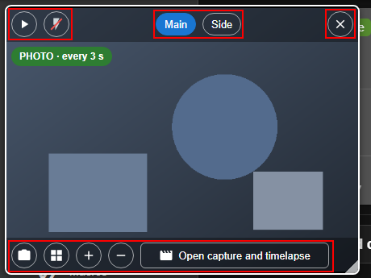
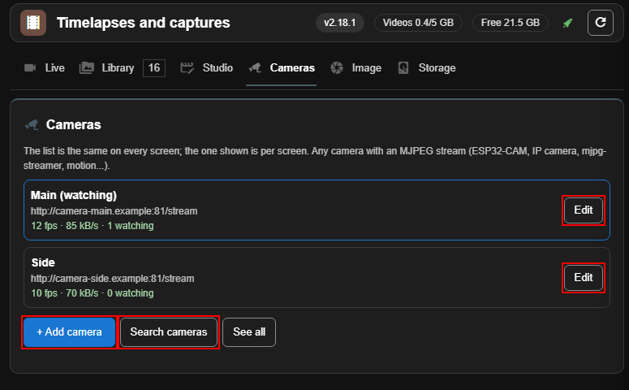
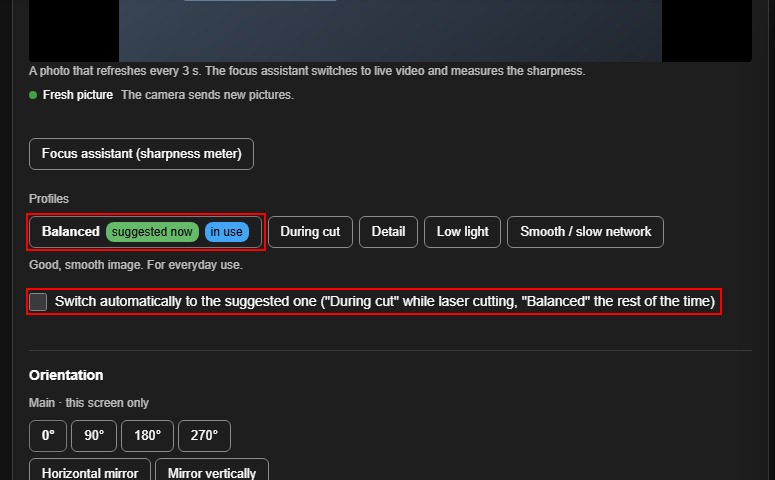
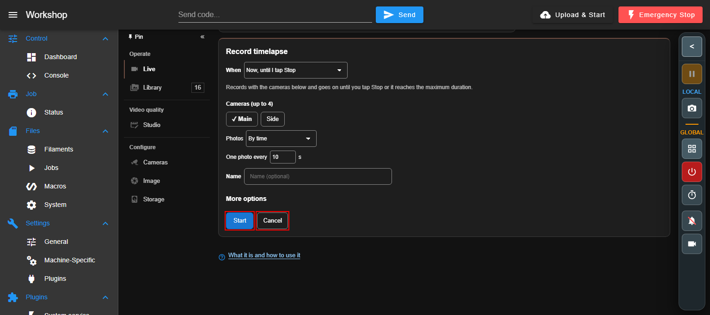
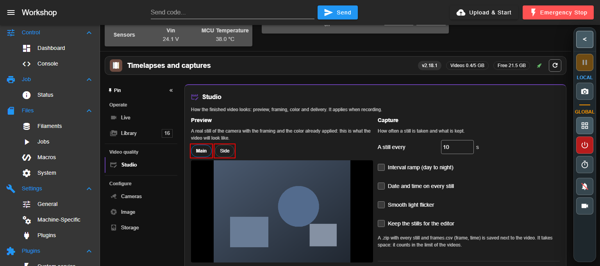
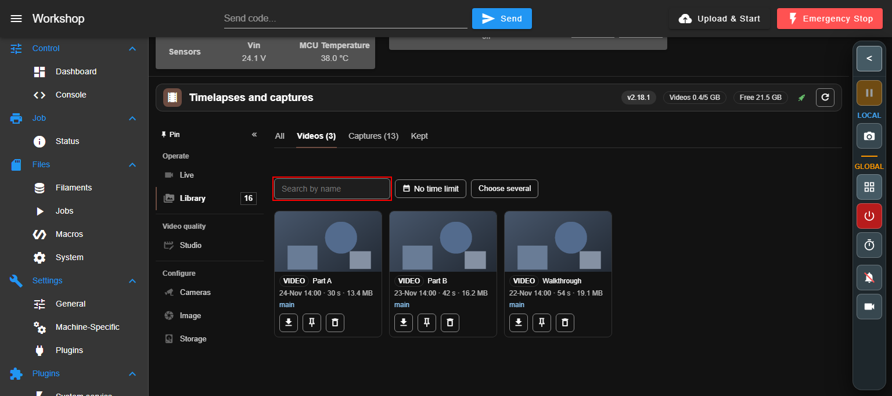
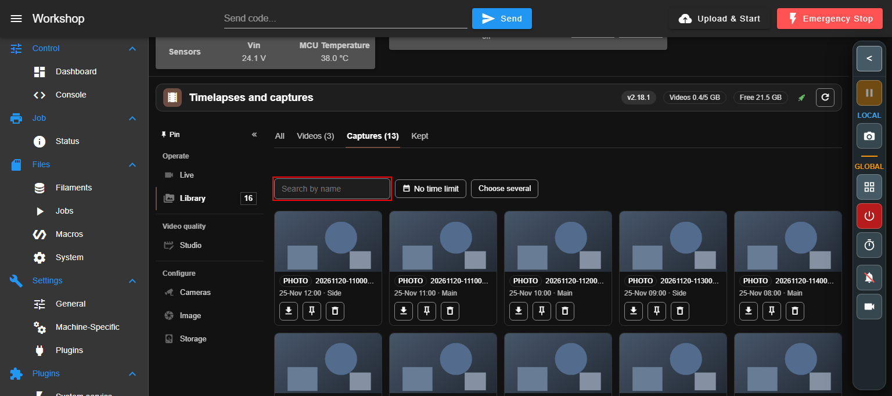
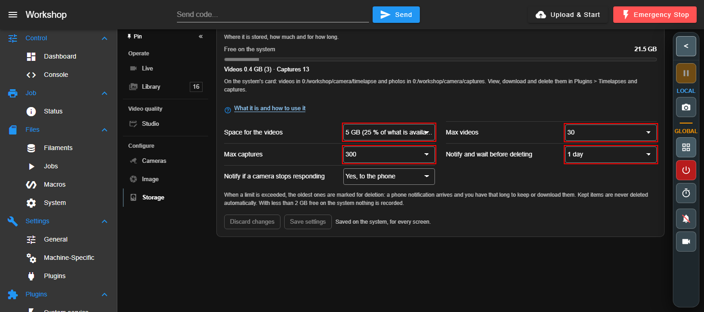

# WorkshopCamera (Camera and timelapses)

<!-- notice:start -->
> **Read before installing.** This plugin runs with real permissions on your machine. Read [SECURITY.md](SECURITY.md) and the section **Permissions and what it changes** below: they say what it can do, which files it writes, and what it sends outside your network (nothing, unless you turn a feature on).

> **The Workshop users and roles do not protect DWC itself.** Anyone who can open DWC on your network can send G-code, move the machine, edit `config.g` and upload files, whatever the Workshop roles say: Duet has no roles of its own. Set a DWC password (`M551`) and keep the machine on a network you trust.
<!-- notice:end -->

Two things in one plugin: (a) a floating camera viewer available on every DWC page (live video, photo capture with date, job and position, focus helper, flash / light, orientation, camera list, start / stop of the system relay and image profiles) and (b) the page `/Plugins/Timelapses` ("Timelapses and captures") that records timelapses of jobs or by hand, edits them, and manages videos and photos. Recording and video building are done by the System service (camera relay on port 8090 and `ffmpeg`; OpenCV is not needed).

Version documented: 2.18.x on DWC 3.6.3.

## 1. Requirements

1. WorkshopService running (camera relay and timelapse engine; it rests only if Camera, Vision and Workbench are all stopped). 2. `ffmpeg` on the Pi. 3. One or more cameras with an MJPEG stream (ESP32-CAM `http://<ip>:81/stream`, or any MJPEG source). Up to 4 cameras. 4. Free space: with less than 2 GB free the system does not record.

## 2. Install

1. Install WorkshopService. 2. DWC > Settings > Plugins > Install `WorkshopCamera-<ver>.zip`; Start. Reload DWC. 3. A camera button appears in the Control bar (side bar, "Camera") and the page "Timelapses and captures" under *Plugins*. 4. Open the page "Timelapses and captures", section Cameras, and add the camera address there. Without a camera the plugin shows "no camera" help.

## 3. Functions

The plugin has two parts: the floating camera viewer (available on every DWC page, opened with the "Camera" button of the Control bar) and the page "Timelapses and captures" (side menu: Plugins > Timelapses and captures). The page side bar has six entries: Live, Library, Studio, Cameras, Image, Storage (see "Page layout" below). Red rectangles mark the control described.

### Floating viewer

Picture 1: the viewer with its top buttons, the camera selector and the bottom buttons (red rectangles).

#### Open and close the viewer
- What: shows the live image of a camera in a window over any page.
- Where: opened by the button "Camera" of the group "LOCAL" in the Control bar; closed with the cross at the top right of the window (picture 1).
- How: 1. Open the Control bar. 2. Press "Camera". 3. Press the cross to close it.
- Watch out: it only affects this screen; no process stops. Closing it is the way to stop watching without cutting the camera for others.

#### Move and resize the window
- What: the window can be dragged and resized from the corner handle at the bottom right.
- Where: the window (picture 1).
- How: drag the window by its top area, or the corner handle.

#### Camera selector
- What: one button per camera ("Main", "Side"); the selected one is blue. When a camera does not answer, the viewer says so and offers Retry.
- Where: top centre of the window (red rectangle, picture 1).
- How: press a camera name.

#### Photo mode and live video
- What: the badge "PHOTO - every 3 s" means the viewer shows a photo every 3 seconds (light on the network); the play button switches to live video ("LIVE") and back.
- Where: round play button at the top left (picture 1, first button).
- How: press it once for live video, again to return to photo mode.
- Watch out: live video uses more network and CPU of the camera.

#### Flash
- What: turns the workshop light strip on for the camera (the ESP32-CAM has no LED of its own). The yellow colour means it is on.
- Where: lightning button at the top left of the window (picture 1, second button, shown only for a camera with a flash).
- How: press it to switch the flash on or off. The system remembers it and switches it off by itself when nobody looks at the camera any more (or after 10 minutes), so closing the viewer never leaves it on.
- Watch out: it changes the real lights.

#### Capture a photo
- What: saves a photo with the date, the job and the position; it appears in "Captures".
- Where: first button of the bottom row (picture 1).
- How: press it.
- Watch out: it writes a file on the system. A camera that does not go through the system relay cannot be captured.

#### All cameras (grid)
- What: shows all the cameras together.
- Where: second button of the bottom row (picture 1).
- How: press it, press again to go back.

#### Zoom in and zoom out
- What: digital zoom of the image.
- Where: third and fourth buttons of the bottom row, "+" and "-" (picture 1).
- How: press them, or use the wheel or a pinch over the image.

#### Open capture and timelapse
- What: opens the page "Timelapses and captures" of this plugin, where a timelapse is started and stopped (section Live, "Record timelapse...").
- Where: wide button of the bottom row (picture 1).
- How: press it.
- Watch out: a timelapse records to the system card and needs more than 2 GB free.

#### Focus assistant
- What: a sharpness meter: turn the lens and the bar rises when the image is sharper; stop at the peak. "Best" keeps the highest value and the restart link clears it. It says "Too dark to focus: turn on the flash" when the image is dark.
- Where: button "Focus assistant (sharpness meter)" of the section Image of the page (the focus tool of the section Live leads to it).
- How: 1. Press it. 2. Turn the lens slowly. 3. Stop at the peak.
- Watch out: it does not work on cameras that do not allow measuring their image.

Picture 2: the section Cameras of the page: the list and its buttons (red rectangles).

#### Cameras section (list)
- What: the list of cameras (the same on every screen; the one shown is per screen) with their address and state ("watching", "at rest - photo in N ms", "not answering for N min"). Any camera with an MJPEG stream works (ESP32-CAM, IP camera, mjpg-streamer, motion).
- Where: section Cameras of the page (picture 2).
- How: press Cameras in the side bar of the page.

#### Edit a camera, Add camera and Search cameras
- What: "Edit" changes a camera (name, address); "+ Add camera" adds one (up to 4); "Search cameras" looks for cameras on the network.
- Where: section Cameras (red rectangles, picture 2).
- How: 1. Press the button. 2. Fill or choose. 3. Save, or cancel.
- Watch out: Technician role.

#### System relay: state, Stop relay and Start relay
- What: the relay is the process of the system (port 8090) that shares the camera video with every screen and makes the captures and timelapses. Its Stop and Start belong to WorkshopService: the row of the camera relay on the page of the System service, and an optional tile of the control bar. This plugin shows where the video of each camera comes from and offers "Restart the relay" in the help that appears when a camera does not respond.
- Where: page of the System service (row of the camera relay); the help of the section Live.
- How: 1. Open the page of the System service. 2. Press Stop or Start in the row of the camera relay; stopping asks for a second tap.
- Watch out: stopping it cuts the camera for EVERYONE watching it now, on every screen, and no capture or timelapse can be made until it starts again. To stop watching only on your screen, close the viewer. Technician role.

#### Orientation
- What: Auto (uses the Vision calibration, only for the calibrated camera), 0, 90, 180, 270 degrees, Horizontal mirror and Mirror vertically; it applies to this screen only.
- Where: "Orientation" in the section Image (picture 3, bottom).
- How: press the option you want.

#### See all
- What: "See all" shows every camera together; the profiles and the orientation are in the section Image.
- Where: button under the list of the section Cameras (picture 2).
- How: press the button.

Picture 3: the section Image: the profiles and the automatic switch (red rectangles), then the orientation.

#### Image profiles
- What: Balanced (good and smooth, for everyday), During cut (less exposure: the laser dot does not burn out the image), Detail (more resolution to align or focus, fewer frames per second), Low light (more exposure and gain, some noise; the flash helps more) and Smooth / slow network (small, light image). One shows "suggested now".
- Where: section Image (picture 3, top).
- How: press a profile to apply it to the camera.
- Watch out: it changes the settings of the real camera.

#### Switch automatically to the suggested profile
- What: when ticked, the viewer uses "During cut" while a laser cut runs and "Balanced" the rest of the time.
- Where: checkbox under the profiles (red rectangle, picture 3).
- How: tick or untick.

#### Fine tuning
- What: finer image values of the camera: resolution, quality and sliders. What you change is saved on top of the chosen profile; choosing a profile clears the fine changes.
- Where: bottom of the section Image (not in picture 3).
- How: change the values.

### Page layout (since 2.12)
The page `/Plugins/Timelapses` has a side bar with six sections in three groups, each one a SINGLE card whose parts are sub-sections. The older "Record / Studio / Videos / Captures / Settings" tabs below were folded into them (the sections below keep describing what each part does): Operate = **Live** (capture now, record a timelapse, light, quick image profiles, the 3 s preview photo, "Open the floating viewer") and **Library** (videos and captures); Video quality = **Studio**; Configure = **Cameras**, **Image** (preview, focus assistant, profile chips, orientation, fine tuning) and **Storage** (usage, limits, notices, and the system relay inside the same card). Choosing a section from far down the page scrolls to its start. Saved tab ids migrate (`record` to Live, `videos` and `captures` to Library, `settings` to Storage). The operator sees Live and Library; the technician sees all six.

### Section: Live (record a timelapse)

Picture 4: the form "Record timelapse" of the section Live, opened with "Record timelapse..." (red rectangles).

#### Record timelapse: Start
- What: records with the cameras and layout of the form until you press Stop. "When" chooses how it starts: "With every job (starts and ends by itself)", "Now, until I tap Stop" or "Scheduled...". A name is optional.
- Where: form "Record timelapse" of the section Live (picture 4).
- How: 1. Press "Record timelapse...". 2. Choose "When" and the cameras. 3. Type a name if you want. 4. Press "Start". 5. Stop it later from the same section or from the viewer page.
- Watch out: with less than 2 GB free on the system it does not start and stops what is recording.

#### Schedule
- What: with "When" set to "Scheduled...", the system starts and stops by itself, even if you close the page: "Starts" and "Stops" date and time, a name and the button "Schedule". Without a start time it starts now; without a stop time it keeps going until Stop or the maximum duration.
- Where: form "Record timelapse" of the section Live.
- How: 1. Choose "Scheduled...". 2. Choose the dates. 3. Press "Schedule".

#### More options
- What: the rest of the settings of the recording (date and time on the photos, maximum duration, how the video is built); "Adjust in the Studio" leads to framing, color and delivery.
- Where: "More options" in the form (picture 4).
- How: unfold it and change the values.

#### Capture now
- What: "Capture all" in the card Actions saves a photo with the date, job and position of the cameras; it shows in the Library.
- Where: card Actions of the section Live (right of the picture).
- How: press the button.
- Watch out: writes a file.

### Section: Studio

Picture 5: the section Studio: "Preview" and "Capture" (the camera buttons of the preview are marked).

#### Preview
- What: a real photo of the camera with the framing and colour already applied: what the video will look like. Buttons choose the camera.
- Where: "Preview" of the section Studio (red rectangles on the camera buttons, picture 5). "New still" takes another photo.
- How: press a camera name.

#### Capture: interval, ramp, date and time, flicker, keep photos
- What: "A still every N s"; "Interval ramp (day to night)"; "Date and time on every still"; "Smooth light flicker"; "Keep the stills for the editor" (a .zip with every still and `frames.csv` is saved next to the video; it takes space and counts in the video limit).
- Where: "Capture" of the section Studio (picture 5).
- How: type the interval and tick the options.

#### Framing, size and slow push
- What: crop to a cinema format (aspect ratio), choose the size and add a slow push (zoom) and stabilization.
- Where: "Framing" under Capture (picture 5, bottom; scroll for the rest).
- How: choose the aspect ratio and the other values.

#### Presets
- What: one tap sets codec, frame, colour and speed: Web 1080p, Cinema 2.39:1, Editor: ProRes, Editor: DNxHR, Vertical 9:16, Quick draft.
- Where: "Presets" of the section Studio (scroll down; at the bottom of picture 5).
- How: press a preset.

### Section: Library (videos and captures)

Picture 6: the tab "Videos (3)" of the section Library with the search box (red rectangle).

#### Videos list: search, select, view, download, rename, trim, speed
- What: searchable list of videos with a checkbox to choose several: name, date, length, size and camera. Each can be viewed, downloaded, renamed, trimmed or sped up (editing creates a NEW video; the original stays). Delete and download are on each item. The names in the picture are sample files.
- Where: section Library, tab Videos (picture 6).
- How: 1. Search by name. 2. Tick one or several. 3. Press the action you need.
- Watch out: delete is permanent.

Picture 7: the tab "Captures (13)" of the section Library with the search box (red rectangle).

#### Captures gallery
- What: the photos with their date, job and position (name `YYYYMMDD-HHMMSS-...`) and the camera; tick several to download or delete.
- Where: section Library, tab Captures (picture 7).
- How: search by name, tick, then press download or delete.
- Watch out: delete is permanent.

### Sections: Live (recording options) and Storage

Picture 8: the section Storage: space for the videos, maximum of videos and captures, and the wait before deleting (red rectangles).

#### Recording
- What: "Timelapse of every job (starts and ends with the job)" on or off; cameras (up to 4); Photos: By time or One per layer (3D printing); one photo every N s; date and time written on each photo; maximum duration (15 min to 24 h, default 12 h): when reached it stops and builds the video; it also stops if less than 2 GB is left free.
- Where: form "Record timelapse" of the section Live, "When" and "More options" (picture 4).
- How: change the values and press "Save settings" at the bottom of the page.

#### How the video is built
- What: Speed (Slow 10 / Normal 15 / Fast 24 / Very fast 30 frames/s); name and date at the start and its size; smooth light changes; hold still at the end (seconds). One hour of recording gives 360 photos per camera and 24 s of video; with 2 or more cameras the video is a mosaic or alternates.
- Where: "More options" of the form "Record timelapse" and the section Studio.
- How: choose the values and save.

#### Where it's stored
- What: videos in `0:/workshop/camera/timelapse` and photos in `0:/workshop/camera/captures`; the space for the videos (1.5 / 4 / 5 / 8 / 11 GB), the maximum number of videos (10 to 200) and captures (100 to 3000), and how long to notify and wait before deleting the oldest (1 hour to 7 days). Kept items are never deleted automatically.
- Where: section Storage (picture 8).
- How: choose the limits and save.
- Watch out: when a limit is exceeded the oldest items are marked for deletion and a phone notification arrives.

#### Phone notifications and Save settings
- What: a warning when a camera stops answering (lower in the page; whether an alert carries a photo or a video is chosen per type in the Activity page); "Save settings" stores everything in the system for every screen.
- Where: bottom of the section Storage (picture 8).
- How: tick the options and press "Save settings".

## 4. Settings

| Setting | Meaning | Default | If wrong |
|---|---|---|---|
| Camera address | MJPEG stream URL; changing it cuts the video a few seconds on all screens | per camera | Wrong URL: no image |
| Go through the relay | Several screens, captures and timelapse | on | Off: direct, no capture or timelapse |
| Photos every N s | Timelapse interval | 10 s | Too short fills the disk |
| Max duration | Auto stop | 12 h | Too long uses space |
| Video limits (GB, count) | Old ones get marked for deletion with a phone notice and a grace period; kept ones never deleted | 5 GB, 30 videos | Over the limit: oldest marked |
| Image profile | Resolution, exposure, gain | Balanced | Laser dot burns the image: use "during cut" |

## 5. Roles

Viewer: sees the camera only if "camera for viewers" is on (service Users section); operator: capture, start / stop timelapse; technician: camera list and settings, start / stop of the system relay; admin: all. The relay (8090) asks the service who calls. Without users: open.

## 6. API operations used

`camera.status` (also the list of cameras), `camera.service`, `camera.detect`, `settings.set` (the list of cameras, `cameras.json`), `camera.start`, `camera.stop`, `camera.flash`, `vision.get`, plus the relay's own endpoints on port 8090 for the video and captures.

## 7. Troubleshooting

1. Black or frozen stream: the camera is off or has no WiFi; changes apply when it returns.
2. "This camera doesn't go through the system relay: it can't be captured.": enable the relay option in its settings.
3. Timelapse does not start: less than 2 GB free, or ffmpeg missing (service preflight shows it).
4. Video never appears: it is built on the system when it ends (a few minutes); see "The system is building a video: it shows up in Videos when it's done.".
5. Phone notice "will be deleted": keep or download it within the grace period.
6. The viewer is black on every screen and the camera relay is stopped: press Start in the row of the camera relay on the page of the System service.

<!-- permissions:start -->

## Permissions and what it changes

Risk: **Low**. Read this before installing; the full document is `security.md` of the Workshop plugins.

**DSF permissions:** none. It is a page of DWC (it runs in your browser) and everything it does goes through the API of `WorkshopService`, which applies the roles (viewer, operator, technician, administrator) in the server.

**Depends on:** `WorkshopService` (install it first, uninstall it last).

**Files it writes:**
- photos and timelapse videos in `0:/workshop/camera/` (outside `sys/` on purpose: they weigh GB)
- its profiles in `0:/sys/workshop/config/`

**What it needs outside the zip** (each one is a separate step you do on purpose and can undo):
- `ffmpeg` on the Pi (done by the service) for videos

**Safety notes:**
- The viewer and the relay follow the users of the service: with no users anyone on the network can watch the camera, but only the Pi itself can change the camera settings until the first administrator exists.

Uninstalling removes the plugin folder; your data in `0:/sys/workshop/` and `/opt/dsf/conf/workshop-*.json` stays.

<!-- permissions:end -->

## 8. Limits

Maximum 4 cameras; MJPEG streams only; videos are built on the Pi (CPU); photos from the viewer need the relay.

